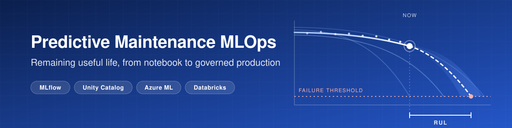
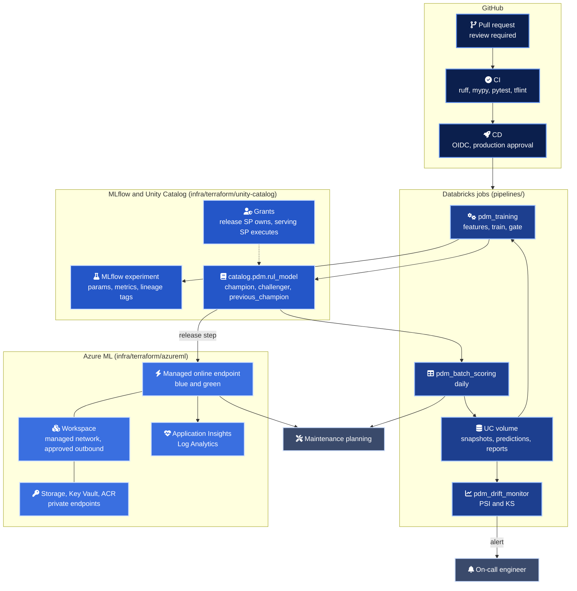
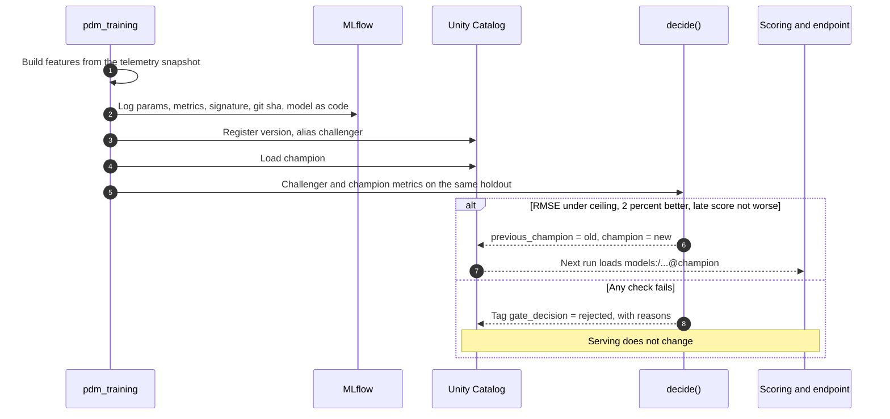
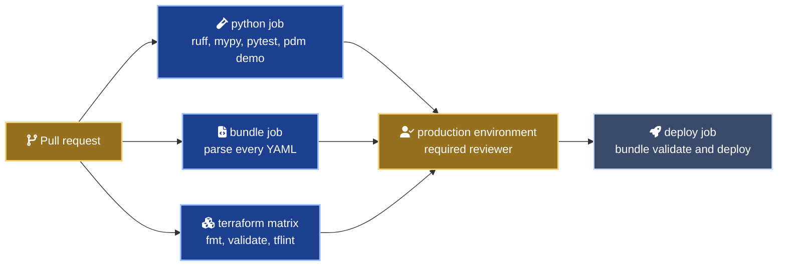

<div align="center">



# mlops-predictive-maintenance

Remaining useful life for industrial machines, taken from a notebook idea to a governed, monitored production model.

<a href="https://mlflow.org/"></a>
<a href="https://www.databricks.com/product/unity-catalog"></a>
<a href="https://learn.microsoft.com/azure/machine-learning/"></a>
<a href="https://developer.hashicorp.com/terraform"></a>
<br>
<a href="https://www.python.org/"></a>
<a href="https://scikit-learn.org/"></a>
<a href=".github/workflows/ci.yml"></a>
<a href="LICENSE"></a>

</div>

## In numbers

Every figure below was measured in this repository. The model metrics come from a local run on synthetic data (`pdm demo`), not from a real plant.

| Measure | Value | Where it comes from |
| --- | --- | --- |
| Champion holdout RMSE (synthetic) | 15.07 cycles | Gradient boosting, last observed cycle of 300 unseen units |
| Champion holdout MAE (synthetic) | 10.85 cycles | Same run |
| Gain over the linear baseline (synthetic) | 8.2 percent RMSE | Ridge baseline at 16.43 cycles |
| Promotion gate outcomes | 2 promoted, 2 rejected | Four candidates in a row, each rejection with its reason tagged |
| Calibration fault detection | PSI 2.835 on the faulty sensor, 0.009 at most elsewhere | 3.0 unit offset on `sensor_04` |
| Units flagged for maintenance | 36 of 300 | Batch scoring at a 30 cycle threshold |
| Full lifecycle on a laptop | 19.5 seconds | Generate, features, 4 trainings, gate, scoring, two drift reports |
| Model inputs | 56 | Rolling mean and spread, 30 cycle slope, baseline deviation, health indicator and its lags |
| Test cases | 53 | Data, features, metrics, gate, drift, serving script, bundle YAML |
| Databricks jobs | 4 jobs, 6 tasks | `pipelines/resources` |
| Terraform resource blocks | 24 | 17 in `infra/terraform/azureml`, 7 in `infra/terraform/unity-catalog` |
| Private endpoints when the toggle is on | 5 | Workspace, blob, file, Key Vault, container registry |
| Architecture decision records | 3 | `docs/adr` |

## What it is

A reference implementation of the part of machine learning that rarely makes it into a notebook. It predicts how many cycles a rotating machine has left before failure, and then does everything a plant needs before trusting that number. Every model version carries its own features, its signature and its lineage. A challenger replaces the champion only when an automated gate says it is better, on the metric that punishes late predictions. Drift is measured every day and turns into an actionable alert.

The data is synthetic and generated by code, in the spirit of public turbofan degradation benchmarks. The platform around it is the real subject.

## Architecture



## How a model reaches production



Measured on the synthetic data, four candidates in a row.

| Candidate | Holdout RMSE | Late-penalising score | Gate decision |
| --- | --- | --- | --- |
| Ridge baseline | 16.43 | 1600.0 | Promoted, first model under the 30 cycle ceiling |
| Gradient boosting, 300 iterations | 15.07 | 1407.2 | Promoted, beats the champion by 8.2 percent |
| Gradient boosting, 500 slow iterations | 14.83 | 1347.0 | Rejected, 1.6 percent is under the 2 percent bar |
| Underfit gradient boosting | 33.57 | 23932.8 | Rejected on ceiling, improvement and late score |

## Environments

| Setting | dev | prod |
| --- | --- | --- |
| Bundle mode | `development`, resources prefixed per user, schedules paused | `production`, runs as the release service principal |
| Catalog | `ml_dev` | `ml_prod` |
| Engineers can create tables and models | Yes (`engineers_can_write = true`) | No, read and execute only |
| Who moves the champion alias | The gate, under the engineer's identity | The gate, under the release service principal that owns the model |
| Azure ML storage replication | LRS | ZRS |
| Workspace high business impact flag | Off | On |
| Deployment | `databricks bundle deploy --target dev` from a laptop | CD job on `main`, behind the `production` environment |

## Quick start

From the repository root, on Python 3.11 or later.

```bash
python -m venv .venv
source .venv/bin/activate
pip install -e ".[dev]"

# The whole lifecycle on a local SQLite MLflow backend, about 20 seconds
pdm demo --workdir .local
cat .local/demo_summary.json

# Quality gates, as CI runs them
ruff check . && ruff format --check .
mypy
pytest
```

Run the stages one by one, as the Databricks tasks do.

```bash
export PDM_TRACKING_URI=sqlite:///.local/mlflow.db
pdm generate --output-dir .local/data
pdm features --data-dir .local/data
pdm train --data-dir .local/data --handoff .local/handoff.json --model-type hgb
pdm evaluate-register --data-dir .local/data --handoff .local/handoff.json
pdm score --input .local/data/current.parquet --output .local/predictions.parquet
pdm drift --reference .local/data/holdout.parquet --current .local/data/current.parquet \
  --thresholds monitoring/thresholds.yml --output .local/drift.json --fail-on-alert
```

On Databricks the same commands receive `--tracking-uri databricks --registry-uri databricks-uc --model-name ml_dev.pdm.rul_model`.

```bash
cd pipelines
databricks bundle validate --target dev
databricks bundle deploy --target dev
databricks bundle run pdm_bootstrap_synthetic_data --target dev
databricks bundle run pdm_training --target dev
```

## Access model

| Identity | Unity Catalog schema | Registered model | Data volume | Azure ML workspace |
| --- | --- | --- | --- | --- |
| `ml-engineers` group | Use, select, execute (write in dev) | Execute | Read (write in dev) | AzureML Data Scientist, optional |
| Release service principal | Use, select, modify, create table and model | Owner, the only identity that moves aliases | Read and write | AzureML Data Scientist for endpoint releases, optional |
| Serving service principal | Use schema | Execute | None | None |
| `ml-platform-admins` group | Owner | None | Owner | None |

## Delivery



The deploy job is off until the repository variable `BUNDLE_DEPLOY` is `true`. It authenticates with GitHub OIDC federation to a Databricks service principal, so no long-lived token is stored. Every action is pinned to a commit SHA resolved with `git ls-remote`.

## Before you touch anything

> [!IMPORTANT]
> The champion alias moves only through `pdm evaluate-register`. In prod the release service principal owns the model, so a manual alias change from the UI fails by design. To ship a model the gate rejected, change `GatePolicy` or the bundle variables in a reviewed pull request.

> [!WARNING]
> The drift job fails its task on purpose when a threshold is crossed (exit code 2). A red drift run is an alert, not a broken pipeline. Read the report in the volume before rerunning anything.

> [!WARNING]
> MLflow 3 puts the plain file store in maintenance mode. Local runs and tests use a SQLite file (`sqlite:///mlflow.db`) with artifacts on disk, which needs the `local` extra (SQLAlchemy and Alembic). Databricks needs neither.

> [!CAUTION]
> `enable_private_networking = true` disables public access on the workspace, storage, Key Vault and registry. Run `terraform apply` from a network that reaches the private endpoints, or the data plane calls that follow will time out.

> [!NOTE]
> Metrics in this README come from synthetic data generated by `src/pdm/data.py`. They show that the pipeline measures, gates and monitors correctly. They say nothing about any real machine.

## Repository map

| Path | What it holds |
| --- | --- |
| `src/pdm/data.py` | Deterministic synthetic fleet, truncation into in-service snapshots, sensor fault injection |
| `src/pdm/features.py` | Rolling, slope, baseline and health indicator features, all backward looking |
| `src/pdm/metrics.py` | RMSE, MAE, the late-penalising asymmetric score, late ratio |
| `src/pdm/train.py` | Grouped split by unit, training, MLflow logging with signature and lineage tags |
| `src/pdm/model.py`, `mlflow_model.py` | Pyfunc model logged as code, raw telemetry in, prediction out |
| `src/pdm/registry.py` | Champion and challenger gate, alias moves, rollback |
| `src/pdm/scoring.py`, `drift.py` | Batch scoring with maintenance flags, PSI and KS drift reports |
| `src/pdm/config.py`, `cli.py` | Local or Unity Catalog settings, the `pdm` command used by every job |
| `pipelines/` | Databricks Asset Bundle, dev and prod targets, four jobs |
| `serving/azureml/` | Endpoint and deployment YAML, scoring script, inference environment |
| `serving/databricks/` | Model Serving alternative, ready to include in the bundle |
| `monitoring/` | Drift thresholds and a measured sample alert report |
| `infra/terraform/azureml/` | Azure ML workspace, storage, Key Vault, ACR, App Insights, private networking toggle |
| `infra/terraform/unity-catalog/` | Schema, volume, registered model, grants |
| `tests/` | 53 tests, including an end to end gate on a real local registry |
| `.github/workflows/ci.yml` | Lint, types, tests, local lifecycle, Terraform, YAML, gated deploy |

## Documentation

| Document | What it answers |
| --- | --- |
| [ML lifecycle](docs/ml-lifecycle.md) | Each stage, where it runs, and what travels with a model version |
| [Model governance](docs/model-governance.md) | Who promotes, which approvals exist, how lineage is recorded |
| [Monitoring and retraining](docs/monitoring-and-retraining.md) | Thresholds, what the demo measured, when to retrain and who decides |
| [Serving](serving/README.md) | Releasing the champion to Azure ML, blue and green, request format |
| [ADR 0001](docs/adr/0001-feature-engineering-inside-the-model.md) | Why features travel inside the model |
| [ADR 0002](docs/adr/0002-alias-based-champion-challenger-gate.md) | Why aliases and an automated gate instead of manual promotion |
| [ADR 0003](docs/adr/0003-azure-ml-online-endpoint-as-primary-serving.md) | Why Azure ML is the primary online path |

<div align="center">
<br>
<sub>Giselle Da Costa · Data and AI platform architecture · MIT licensed</sub>
</div>
