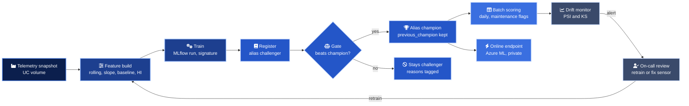

# ML lifecycle

From raw telemetry to a governed prediction, every stage is one subcommand of the `pdm` package. The laptop, the CI runner and the Databricks jobs call the same code with different settings.

| Stage | Command | Runs in | Output |
| --- | --- | --- | --- |
| Seed data (once) | `pdm generate` | `pdm_bootstrap_synthetic_data` job | `train`, `holdout`, `current` parquet in the volume |
| Feature build | `pdm features` | `pdm_training`, task 1 | `features.parquet`, 56 model inputs |
| Train | `pdm train` | `pdm_training`, task 2 | MLflow run with params, metrics, signature and a handoff file |
| Evaluate and register | `pdm evaluate-register` | `pdm_training`, task 3 | New model version, gate tags, aliases moved only on success |
| Batch scoring | `pdm score` | `pdm_batch_scoring` | Latest prediction per unit and a `maintenance_due` flag |
| Online scoring | `serving/azureml/score.py` | Azure ML managed online endpoint | JSON answer per unit |
| Drift | `pdm drift --fail-on-alert` | `pdm_drift_monitor` | JSON report, failed task and email on alert |

## Why the holdout is shaped the way it is

Run-to-failure data is not what the model sees in service. In service, a unit is observed somewhere in the middle of its life and the question is how much is left. The holdout reproduces that. Each unit of an unseen fleet is cut at a random cycle between 30 percent of its life and its failure, and the model is scored on its prediction at the last observed cycle only. Targets are capped at 125 cycles, the usual piecewise linear convention for remaining useful life, because nobody plans maintenance 300 cycles ahead.

The same holdout is the drift reference. It is the population the champion was last validated against, so it is the right yardstick for "has the fleet changed since we promoted".

## What travels with a model version

| Item | Where | Why |
| --- | --- | --- |
| Estimator and column order | `artifacts/estimator.joblib` | Exact inputs at fit time |
| Feature configuration | `artifacts/feature_config.json` | Window sizes and sensors, so serving cannot drift from training |
| Feature code | `code/pdm` | Models from code, no pickled class |
| Signature | `MLmodel` | Raw telemetry in, `unit_id`, `cycle`, `predicted_rul` out. Required by Unity Catalog |
| Input example | `input_example.json` | 40 rows of real shaped telemetry, validated at log time |
| Pinned requirements | `requirements.txt` | numpy, pandas, scikit-learn and mlflow-skinny at training versions |
| Lineage tags | run tags | `pdm.git_sha`, `pdm.data_version`, `pdm.package_version`, `pdm.model_type` |
| Gate evidence | model version tags | `gate_rmse`, `gate_score`, `gate_decision`, `gate_reasons`, `gate_compared_with` |
