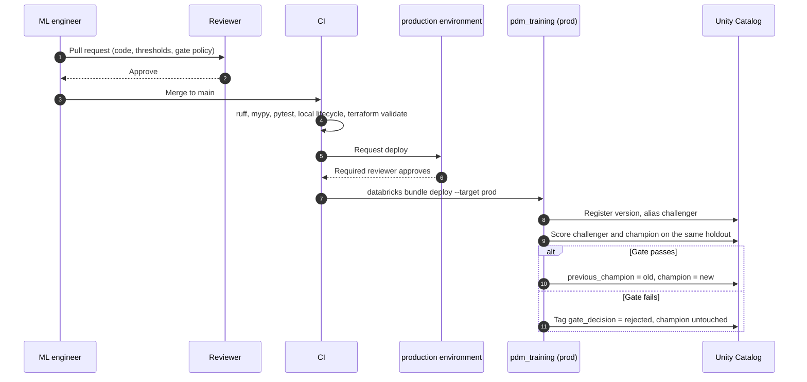

# Model governance

The rule is simple. A person decides what the gate checks. Only the pipeline decides what passes it.

## Who does what

| Action | Who | How it is enforced |
| --- | --- | --- |
| Change features, training code or the gate policy | ML engineer, reviewed by a second engineer | Pull request to `main`, CI must pass (ruff, mypy, pytest, the full local lifecycle) |
| Deploy jobs to prod | Release service principal | CD job in `.github/workflows/ci.yml`, GitHub `production` environment with required reviewers, OIDC federation, no stored token |
| Register a model version in prod | Release service principal | Only identity with `CREATE_MODEL` on the prod schema (`infra/terraform/unity-catalog`) |
| Move the `champion` alias | Release service principal, through `pdm evaluate-register` | The principal owns the registered model. In Unity Catalog alias changes need ownership or `MANAGE`, which no human holds in prod |
| Roll back | On-call engineer requests, release principal executes | `pdm.registry.rollback` swaps `champion` and `previous_champion` in one step, from a manual run of the job |
| Load the champion for serving | Serving identity | `EXECUTE` on the model and nothing else |
| Read predictions and drift reports | ML engineers | `READ_VOLUME` on the data volume |

In dev, `engineers_can_write = true` lets engineers create tables and models in their own catalog, so they can iterate without the release identity.

## Approvals

There are two human approvals (the code review and the environment reviewer) and zero human alias moves. A model that a person likes but the gate rejects does not ship. The fix is to change the gate policy in a reviewed pull request, which leaves a trace.

## Lineage

Unity Catalog records which job run, notebook or user created each version, and MLflow records the run behind it. This repository adds what neither knows on its own.

| Question | Answer lives in |
| --- | --- |
| Which commit produced this model? | Run tag `pdm.git_sha` (from `GITHUB_SHA` in CI or `git rev-parse` locally) |
| Which data? | Run tag `pdm.data_version` and the volume path in the job parameters |
| Which feature definition? | `feature_config.json` inside the model and run params `fe_*` |
| Why was it promoted, or not? | Version tags `gate_decision`, `gate_reasons`, `gate_compared_with` |
| What was serving before? | Alias `previous_champion` |

## The gate

Defined in `src/pdm/registry.py` as a pure function, with its defaults in `GatePolicy` and its overrides in the bundle variables `max_rmse` and `min_improvement`.

| Check | Default | Applies when |
| --- | --- | --- |
| RMSE at or under the ceiling | 30 cycles | Always, including the very first model |
| RMSE improves on the champion | at least 2 percent | A champion exists |
| Late-penalising score does not get worse | 0 percent tolerance | A champion exists |

The third check is the one that protects the plant. A model can lower RMSE by predicting more optimistically, which looks good on average and causes unplanned stops. The asymmetric score grows faster for late predictions, so that trade is rejected.

Measured on the synthetic data (`pdm demo`), four candidates in a row produce four different outcomes.

| Candidate | Holdout RMSE | Asymmetric score | Gate |
| --- | --- | --- | --- |
| Ridge baseline | 16.43 | 1600.0 | Promoted, no champion yet |
| Gradient boosting, 300 iterations | 15.07 | 1407.2 | Promoted, 8.2 percent better |
| Gradient boosting, 500 slow iterations | 14.83 | 1347.0 | Rejected, 1.6 percent is under the 2 percent bar |
| Underfit gradient boosting | 33.57 | 23932.8 | Rejected on all three checks |
